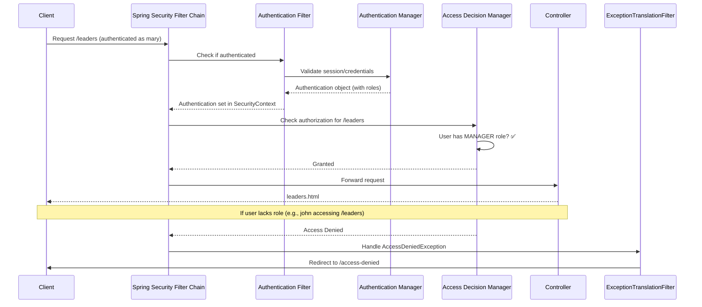

# 🔒 Spring Boot MVC Security Demo – Role-Based Authentication & Authorization

This project demonstrates **Spring Security** integration into a Spring Boot web application. It showcases **authentication** (in-memory users) and **authorization** (role-based access control) with custom login pages, role-specific content rendering using **Thymeleaf extras**, and proper security configuration via the **SecurityFilterChain**.

---

## 🛠️ Technologies Used

| Category                | Technology                                                                               | Icon |
|-------------------------|------------------------------------------------------------------------------------------|------|
| **Backend**             | Spring Boot 4.x, Spring MVC, Spring Security                                             | 🍃   |
| **Frontend**            | Thymeleaf, HTML5, Bootstrap 5, CSS                                                       | 🎨   |
| **Security**            | Spring Security 6.x (Filter Chain, InMemoryUserDetailsManager, Role-based access)        | 🔐   |
| **Template Extras**     | Thymeleaf Extras Spring Security 6 (`sec:*` attributes)                                  | 🔌   |
| **Build Tool**          | Maven                                                                                    | 📦   |
| **Development**         | Java 21, Spring Boot DevTools (hot reload)                                               | ☕   |

---

## 📁 Project Structure

```
spring-boot-spring-mvc-security/
├── src/
│   ├── main/
│   │   ├── java/
│   │   │   └── dev/jaqs/demomvcsecurity/
│   │   │       ├── DemomvcsecurityApplication.java          # 🚪 Spring Boot entry point
│   │   │       ├── controller/
│   │   │       │   ├── DemoController.java                  # 🎮 Handles home, leaders, systems, access-denied
│   │   │       │   └── LoginController.java                 # 🎮 Serves custom login page
│   │   │       └── security/
│   │   │           └── DemoSecurityConfig.java              # 🔐 Security configuration (users, filter chain)
│   │   └── resources/
│   │       ├── static/
│   │       │   └── css/
│   │       │       └── style.css                            # 🎨 Simple error styling
│   │       └── templates/
│   │           ├── home.html                                # 🏠 Main landing page (dynamic role-based links)
│   │           ├── leaders.html                             # 👔 Manager-only page
│   │           ├── systems.html                             # 🖥️ Admin-only page
│   │           ├── access-denied.html                       # 🚫 Custom 403 page
│   │           ├── fancy-login.html                         # 🎨 Bootstrap-styled login form
│   │           └── plain-login.html                         # 📝 Simple unstyled login form
│   └── test/
└── pom.xml                                                   # 📦 Maven dependencies
```

---

## 🔐 Authentication – In-Memory Users

Users are defined **in-memory** using `InMemoryUserDetailsManager`. This is perfect for demos and testing.

```java
@Bean
public InMemoryUserDetailsManager userDetailsManager() {
    UserDetails john = User.builder()
        .username("john")
        .password("{noop}test123")   // {noop} means no password encoding (plain text)
        .roles("EMPLOYEE")
        .build();
    UserDetails mary = User.builder()
        .username("mary")
        .password("{noop}test123")
        .roles("EMPLOYEE", "MANAGER")
        .build();
    UserDetails susan = User.builder()
        .username("susan")
        .password("{noop}test123")
        .roles("EMPLOYEE", "MANAGER", "ADMIN")
        .build();
    return new InMemoryUserDetailsManager(john, mary, susan);
}
```

### 🔑 User Roles Summary

| Username | Password | Roles                          | Accessible Pages                          |
|----------|----------|--------------------------------|-------------------------------------------|
| `john`   | test123  | `EMPLOYEE`                     | `/` (home) only                           |
| `mary`   | test123  | `EMPLOYEE`, `MANAGER`          | `/`, `/leaders`                           |
| `susan`  | test123  | `EMPLOYEE`, `MANAGER`, `ADMIN` | `/`, `/leaders`, `/systems`               |

> ⚠️ **Note**: `{noop}` is used for plain-text passwords. In production, always use a password encoder like `bcrypt`.

---

## 🛡️ Authorization – Role-Based Access Control

Authorization rules are configured in the `SecurityFilterChain` bean:

```java
http.authorizeHttpRequests(configurer ->
        configurer
            .requestMatchers("/css/**").permitAll()           // CSS files are public
            .requestMatchers("/").hasRole("EMPLOYEE")        // Home requires EMPLOYEE role
            .requestMatchers("/leaders/**").hasRole("MANAGER") // /leaders requires MANAGER
            .requestMatchers("/systems/**").hasRole("ADMIN")   // /systems requires ADMIN
            .anyRequest().authenticated()                     // All other requests need authentication
    )
    .formLogin(form ->
        form
            .loginPage("/showLoginPage")                       // Custom login page
            .loginProcessingUrl("/authenticateTheUser")        // Login POST endpoint
            .permitAll()
    )
    .logout(logout -> logout.permitAll())                      // Enable logout
    .exceptionHandling(configurer ->
        configurer.accessDeniedPage("/access-denied")          // Custom 403 page
    );
```

### 🧭 Access Rules Visualized

```mermaid
graph TD
    A[Request] --> B{Is path /css/**?}
    B -->|Yes| C[Permit All]
    B -->|No| D{Is path /?}
    D -->|Yes| E[Require EMPLOYEE role]
    D -->|No| F{Is path /leaders/**?}
    F -->|Yes| G[Require MANAGER role]
    F -->|No| H{Is path /systems/**?}
    H -->|Yes| I[Require ADMIN role]
    H -->|No| J[Authenticated (any role)]
    C --> K[Access Granted]
    E --> L{User has EMPLOYEE?}
    L -->|Yes| K
    L -->|No| M[Access Denied -> /access-denied]
    G --> N{User has MANAGER?}
    N -->|Yes| K
    N -->|No| M
    I --> O{User has ADMIN?}
    O -->|Yes| K
    O -->|No| M
    J --> P{Is user authenticated?}
    P -->|Yes| K
    P -->|No| Q[Redirect to login]
```

---

## 🔄 Spring Security Filter Chain – How Requests Are Intercepted

Spring Security relies on a chain of filters. The main filters in this flow:

1. **UsernamePasswordAuthenticationFilter** – processes login form submissions.
2. **ExceptionTranslationFilter** – handles access denied exceptions and sends to login or error page.
3. **FilterSecurityInterceptor** – makes the final authorization decision based on configured rules.



---

## 📝 Custom Login Pages

Two login pages are provided: `fancy-login.html` (Bootstrap styled) and `plain-login.html` (simple). Both are configured to POST to `/authenticateTheUser`.

### Important Fields in Login Form

- `name="username"` – Spring Security expects this exact name (can be customized).
- `name="password"` – likewise.
- Form action: `th:action="@{/authenticateTheUser}"` – matches `loginProcessingUrl` in config.

### Displaying Login Errors & Logout Messages

```html
<!-- Login error (invalid credentials) -->
<div th:if="${param.error}" class="alert alert-danger">
    Invalid username and password.
</div>

<!-- Logout success message -->
<div th:if="${param.logout}" class="alert alert-success">
    You have been logged out successfully.
</div>
```

Spring Security appends `?error` or `?logout` to the URL upon login failure or logout, so Thymeleaf can detect these parameters.

---

## 🚪 Logout

Logout is enabled with `logout.permitAll()`. In `home.html`, a logout button is provided:

```html
<form action="#" th:action="@{/logout}" method="POST">
    <input type="submit" value="Logout"/>
</form>
```

POST is used to prevent CSRF attacks. Spring Security automatically handles the logout and redirects to the login page with `?logout`.

---

## 🧩 Thymeleaf Extras Spring Security – Displaying User Info & Conditional Rendering

The `thymeleaf-extras-springsecurity6` dependency adds special attributes for security in templates.

### Show Current Username and Roles

```html
<p>
    User: <span sec:authentication="principal.username"></span><br><br>
    Role(s): <span sec:authentication="principal.authorities"></span>
</p>
```

- `sec:authentication` accesses the current `Authentication` object.

### Conditional Rendering Based on Roles

```html
<!-- Visible only to MANAGERs -->
<div sec:authorize="hasRole('MANAGER')">
    <a th:href="@{/leaders}">Leadership Meeting</a> (Only for Manager peeps)
</div>

<!-- Visible only to ADMINs -->
<div sec:authorize="hasRole('ADMIN')">
    <a th:href="@{/systems}">IT Systems Meeting</a> (Only for Admin peeps)
</div>
```

- `sec:authorize` evaluates the expression; if true, the content is rendered.

---

## 🚫 Custom Access Denied Page

When a user tries to access a resource they are not authorized for, Spring Security redirects to `/access-denied` (configured in `exceptionHandling`). The page is simple and provides a link back home.

```html
<h2>Access Denied - You are not authorized to access this resource.</h2>
<a th:href="@{/}">Back to Home Page</a>
```

---

## 🧪 Testing the Application

### Credentials & Access

| Username | Password | Can access                           | Cannot access          |
|----------|----------|--------------------------------------|------------------------|
| john     | test123  | `/`                                  | `/leaders`, `/systems` |
| mary     | test123  | `/`, `/leaders`                      | `/systems`             |
| susan    | test123  | `/`, `/leaders`, `/systems`          | –                      |

### Steps

1. Run the application:
   ```bash
   ./mvnw spring-boot:run
   ```
2. Open browser: [http://localhost:8080/](http://localhost:8080/)
    - You'll be redirected to the custom login page (`/showLoginPage`).
3. Log in with any of the above users.
4. The home page shows your username/roles and role-specific links.
5. Try accessing restricted URLs directly (e.g., `/leaders` as `john`) – you'll be redirected to the access-denied page.
6. Click logout – you're logged out and see a logout message on the login page.

---

## 📚 Key Security Concepts Demonstrated

| Concept                      | Implementation                                                                 |
|------------------------------|--------------------------------------------------------------------------------|
| ✅ **Authentication**         | `InMemoryUserDetailsManager` with users, passwords, roles                     |
| ✅ **Authorization**          | `requestMatchers().hasRole()` in `SecurityFilterChain`                        |
| ✅ **Custom Login Page**      | `loginPage("/showLoginPage")` and `loginProcessingUrl("/authenticateTheUser")`|
| ✅ **Logout**                 | `.logout(logout -> logout.permitAll())` + POST form                           |
| ✅ **Password Encoding**      | `{noop}` prefix (plaintext) – for demo only                                   |
| ✅ **Role Hierarchy**         | Not implemented, but roles are hierarchical (EMPLOYEE < MANAGER < ADMIN)      |
| ✅ **Access Denied Handling** | `.exceptionHandling().accessDeniedPage("/access-denied")`                     |
| ✅ **CSRF Protection**        | Enabled by default (logout uses POST)                                         |
| ✅ **Thymeleaf Integration**  | `sec:authentication`, `sec:authorize`                                         |
| ✅ **Static Resources**       | `.requestMatchers("/css/**").permitAll()` – allow CSS without login           |

---

## 🔜 Next Steps & Enhancements

- 🔐 **Replace `{noop}` with a real password encoder** (e.g., `bcrypt`).
- 🗄️ **Use a database for user details** with `UserDetailsService` or `JdbcUserDetailsManager`.
- 🧑‍🤝‍🧑 **Implement role hierarchy** (so `ADMIN` inherits `MANAGER` and `EMPLOYEE`).
- 🌐 **Add remember-me functionality**.
- 🛡️ **Method-level security** with `@PreAuthorize` annotations.
- 🧪 **Write integration tests** for secured endpoints.

---

## 📖 References

- [Spring Security Reference](https://docs.spring.io/spring-security/reference/index.html)
- [Thymeleaf + Spring Security](https://www.thymeleaf.org/doc/tutorials/3.1/thymeleafspring.html#integrating-thymeleaf-with-spring-security)
- [Bootstrap 5](https://getbootstrap.com/docs/5.3/getting-started/introduction/)

---

**Happy Secure Coding!** 🔒✨  
If you found this project helpful, please ⭐ it on GitHub!